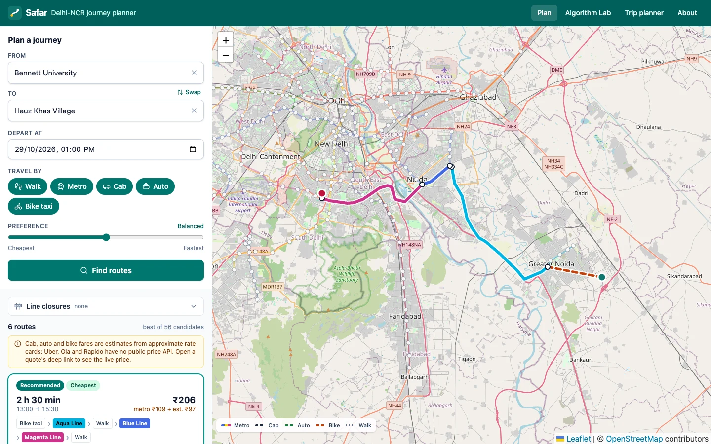
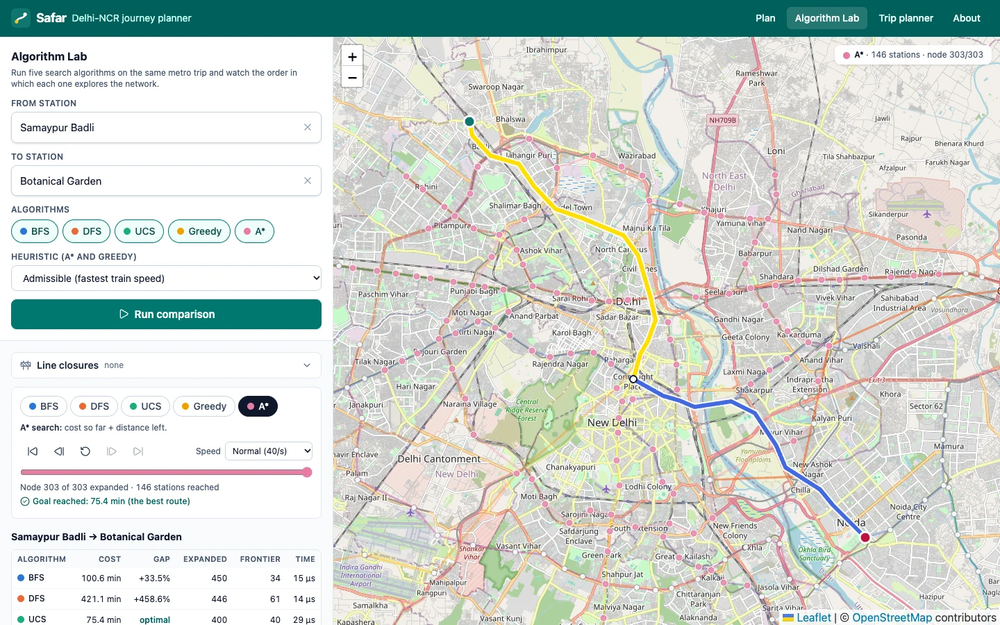
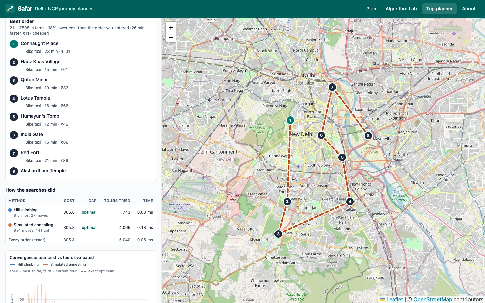
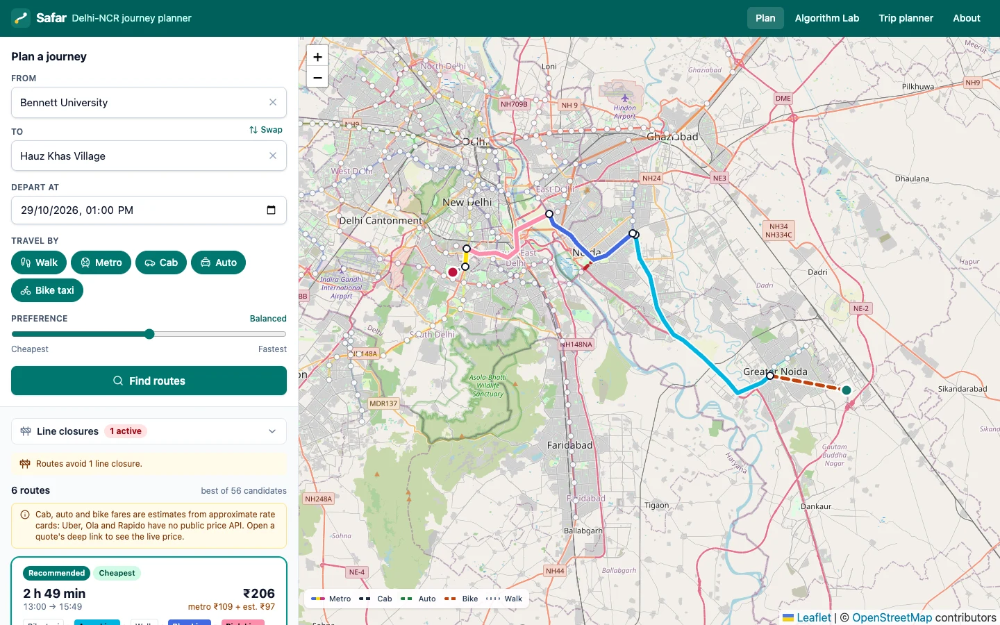
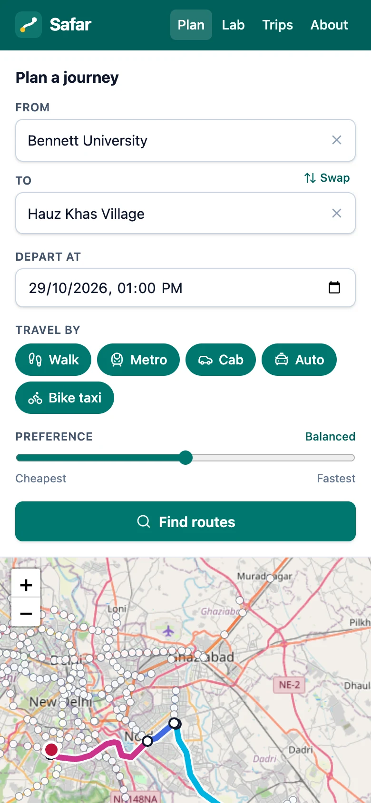

# Safar

AI multi-modal journey planner for Delhi-NCR. It combines metro, cab, auto, bike taxi and walking
into one trip, and shows the time, distance and price of every route. The routing is done with
classic AI search (BFS, DFS, UCS, Greedy, A*) and local search (hill climbing, simulated annealing).

See [PLAN.md](PLAN.md) for the full design and milestones.

## Project summary

Safar is the Application of AI (CSET381) course project at Bennett University. Ask it for a trip
such as *Bennett University → Hauz Khas Village* and it returns a handful of genuinely different
routes (cab to the metro then Magenta Line, metro all the way with a walk, a direct cab, ...),
each tagged recommended, fastest, cheapest or fewest changes, with timed legs, metro tickets per
operator and every Uber / Ola / Rapido / auto-meter quote on the road legs.

- **Search as the core.** The metro network (16 lines, 289 stations, from OpenStreetMap) and the
  road links between 145 places are one weighted graph. A* with an admissible straight-line /
  top-speed heuristic is the production router; Yen's k-shortest paths and a sweep over the
  value of time give the alternatives, and a Pareto filter keeps only routes that are not worse on
  both time and money.
- **Algorithm Lab.** Runs BFS, DFS, UCS, Greedy best-first and A* on the same query and animates
  how each one expands the map, with the route cost, optimality gap, nodes expanded and runtime.
- **Trip planner.** Orders 3 to 10 stops (a travelling-salesman problem) with hill climbing and
  simulated annealing, plots both convergence curves and reports the gap to the exact optimum.
- **Line closures.** Close a station or a section on any map; every planner routes around it.
- **Prices.** Official DMRC fare slabs; cab, auto and bike fares from rate cards that can be
  re-fitted by least squares on real quotes (`scripts/fit_fares.py`), each with a link to the
  provider's app for the live price.
- **Engineering.** C++20 backend (cpp-httplib, nlohmann/json, spdlog) with 100 GoogleTest tests,
  React + TypeScript + Vite + Tailwind + Leaflet frontend with 48 Vitest tests, Docker images for
  both, and CI that builds, tests and smoke-tests everything on every push.

## Screenshots

| Plan a journey | Algorithm Lab |
|---|---|
|  |  |
| **Trip planner** | **Line closure** |
|  |  |

<p align="center"></p>

## Run it

### With Docker (one command)

Needs Docker with Compose v2 (Docker Desktop, or Colima on a Mac).

```bash
docker compose up --build
```

Then open **http://localhost:8080**. The first build compiles the C++ server and runs its unit
tests inside the image, so it takes a few minutes; later builds reuse the cache. Use another port
with `SAFAR_WEB_PORT=3000 docker compose up --build`; stop with `Ctrl+C` or `docker compose down`.

Two containers start: `backend` (the C++ server, not published on the host) and `web` (nginx with
the built frontend, proxying `/api` to the backend). The browser only talks to nginx, so the API
works through the same port, for example `curl localhost:8080/api/v1/health`.

To build the images one at a time (lighter on a laptop):

```bash
docker compose build backend
```

```bash
docker compose build web
```

```bash
docker compose up
```

### Manually (for development)

**Backend.** Needs CMake ≥ 3.20, Ninja and a C++20 compiler. Dependencies are downloaded
automatically.

```bash
cmake -S backend -B backend/build -G Ninja -DCMAKE_BUILD_TYPE=Release
cmake --build backend/build
ctest --test-dir backend/build --output-on-failure
cd backend && ./build/safar_server config/server.json
```

It listens on http://localhost:8080 (check http://localhost:8080/api/v1/health).

**Frontend.** Needs Node.js ≥ 22.12. With the backend running on :8080 (the dev server proxies
`/api` to it; set `SAFAR_API` to point elsewhere):

```bash
cd frontend
npm install
npm run dev        # http://localhost:5173
```

`npm run lint`, `npm run typecheck`, `npm test` (Vitest) and `npm run build` are what CI runs.

### Configuration

The frontend always calls a same-origin `/api/v1`, so the same build works behind any host. The
server reads `backend/config/server.json`; every key can be overridden by an environment variable.

| Variable | Default | What it does |
|---|---|---|
| `SAFAR_PORT` | `8080` | port the C++ server listens on |
| `SAFAR_HOST` | `0.0.0.0` | address it binds to |
| `SAFAR_CORS_ORIGIN` | `http://localhost:5173` (`http://localhost:8080` in Docker) | `Access-Control-Allow-Origin`; only needed when a page on another origin calls the API directly |
| `SAFAR_LOG_LEVEL` | `info` | `debug`, `info`, `warn`, `error` |
| `SAFAR_DATA_DIR` | `data/processed` | folder with `metro.json`, `places.json`, `road_matrix.json` |
| `SAFAR_API_URL` | `http://backend:8080` | web container only: where nginx proxies `/api` |
| `SAFAR_WEB_PORT` | `8080` | Compose only: host port for the web container |

No keys or secrets are needed anywhere.

## Deploy to Render (free)

[`render.yaml`](render.yaml) is a Render Blueprint for two free Docker web services in Singapore:
`safar-delhi-api` (the backend) and `safar-delhi` (nginx + frontend). Free services sleep after 15 minutes
without traffic, so the first request after a pause takes about a minute.

1. Push this repository to GitHub (Render deploys from a Git host).
2. Sign in at [render.com](https://render.com) with GitHub.
3. Click **New → Blueprint**, pick the repository and keep the branch you want to deploy.
4. Render reads `render.yaml` and asks for two values. Enter the URLs the services will get:
   `SAFAR_API_URL` = `https://safar-delhi-api.onrender.com` and
   `SAFAR_CORS_ORIGIN` = `https://safar-delhi.onrender.com`. Click **Apply**.
5. Wait for both builds (the API build compiles and tests the server, about 5-10 minutes).
6. Open each service in the dashboard and check its URL. If Render added a suffix because a name
   was taken (e.g. `safar-delhi-api-x7k2.onrender.com`), go to **safar-delhi → Environment**, fix
   `SAFAR_API_URL` (and `SAFAR_CORS_ORIGIN` on safar-delhi-api), and save; Render redeploys.
7. Open the `safar-delhi` URL and plan *Bennett University → Hauz Khas Village*.

Pushes to the deployed branch redeploy automatically; the build filters in `render.yaml` only
rebuild the service whose files changed. Line closures are kept in memory, so they reset when the
API service sleeps or redeploys.

## Using the app

The **Plan** screen has from/to autocomplete over places and metro stations, a departure time, mode
toggles (walk, metro, cab, auto, bike) and a cheapest↔fastest slider. Each route card shows its
tags, total time, arrival, fare, distance and changes; expand it for the timed step-by-step legs,
every provider quote on cab/auto/bike legs with an "open in app" link, and the metro tickets per
operator (official vs approximate fare). The selected route is drawn on the map leg by leg (metro in
line colours, road legs dashed, walks dotted) over a faint layer of every metro line. After the
first search, changing the modes, time or slider re-plans straight away. **About** lists the data
sources, OSM attribution and which prices are estimates.

Screens: Plan (`#/`), Algorithm Lab (`#/lab`), Trip planner (`#/trips`), About (`#/about`). Click a
station or a line on any map to close or reopen it.

## API

| Endpoint | What it returns |
|---|---|
| `GET /api/v1/health` | status, version, loaded data counts |
| `GET /api/v1/places?q=hauz&limit=5` | autocomplete over places + metro stations |
| `GET /api/v1/metro/lines` | every line with colour, operator and station order |
| `GET /api/v1/metro/stations[/<id>]` | station coordinates and the lines serving them |
| `POST /api/v1/journeys` | multi-modal routes between two places/stations: walk + metro + cab/auto/bike, with time, fare, distance, tickets and tags (recommended, fastest, cheapest, fewest changes, most expensive). Every road leg lists per-provider quotes in `options` |
| `GET /api/v1/fares/estimate?from=&to=&at=` | every provider's quote for one road trip (Uber Go / Premier / XL, Ola Mini / Prime, Rapido Bike / Auto / Cab, Delhi auto meter), cheapest first |
| `POST /api/v1/lab/compare` | run BFS / DFS / UCS / Greedy / A* on one station-to-station query: route, cost, optimality gap, nodes expanded, runtime, expansion order |
| `GET /api/v1/disruptions` | current line closures (`items`, `version`) |
| `POST /api/v1/disruptions` | close a station `{"type":"station","station":"rajiv-chowk"}` or a section `{"type":"segment","line":"yellow","from":"green-park","to":"hauz-khas"}` (201; 200 with `"added": false` if already closed) |
| `DELETE /api/v1/disruptions[/<id>]` | reopen one closure (`station:<id>`, `segment:<line>:<a>:<b>`) or all of them |
| `POST /api/v1/trips/optimize` | best order to visit 3-10 stops (first = start, optional `round_trip`): hill climbing and/or simulated annealing on a matrix of planned journeys, with totals, each leg's route, convergence curves and the gap to the exact optimum |

Closures are server state (in memory, at most 50): journeys, the Algorithm Lab and the trip planner
all route around them. A closed station is skipped (no boarding, alighting or changing; trains
run through), a closed section stops trains between two neighbouring stations.

Try it (against Docker on :8080 or the manual backend):

```bash
curl -s -X POST localhost:8080/api/v1/journeys \
  -d '{"from":"bennett-university","to":"hauz-khas-village","depart_at":"2026-10-27T09:00"}'
```

```bash
curl -s -X POST localhost:8080/api/v1/disruptions \
  -d '{"type":"segment","line":"yellow","from":"green-park","to":"hauz-khas"}'
```

```bash
curl -s -X POST localhost:8080/api/v1/trips/optimize \
  -d '{"stops":["connaught-place","india-gate","red-fort","qutub-minar","lotus-temple"]}'
```

```bash
curl -s 'localhost:8080/api/v1/fares/estimate?from=bennett-university&to=station:pari-chowk&at=2026-10-27T18:30'
```

## Rebuild the data

The processed data in `data/processed/` is committed, so this is only needed to refresh it.

```bash
python3 scripts/fetch_metro_osm.py      # download metro routes from OpenStreetMap
python3 scripts/build_metro_graph.py    # -> data/processed/metro.json
python3 scripts/build_places.py         # geocode data/curated/places.csv -> places.json
python3 scripts/prefetch_road_matrix.py # real road km + drive times from OSRM -> road_matrix.json
```

## Calibrate cab / auto / bike fares

Uber, Ola and Rapido have no public price API, so their fares are estimates from rate cards in
`backend/config/providers.json`. To make them data-driven, check the apps on real trips and add one
row per quote to `data/fare_samples.csv`:

```
provider,product,from,to,km,minutes,hour,quoted_fare,date,source
uber,go,Bennett University,Pari Chowk metro,7.4,16,9,178,2026-10-20,app
```

`km` / `minutes` are what the app shows for the trip, `hour` is 0-23, `source` is `app` (rows marked
`example` are illustrative and ignored). Then fit `fare / surge(hour) = base + per_km·km + per_min·min`
per product with least squares:

```bash
python3 scripts/fit_fares.py --dry-run   # print the MAE table only
python3 scripts/fit_fares.py             # also write the fitted values into providers.json
```

A product needs at least 3 quotes (8+ recommended). Fitted cards get `"basis": "fitted"` and a `fit`
block with the sample count, MAE and date. The Delhi auto meter is the government rate card and is
never refitted.

## Fares and data sources

Fares: DMRC slabs are the official ones from 25 Aug 2025. Airport Express, NMRC, Rapid Metro and
Namo Bharat fares are approximate (`"verified": false` in `backend/config/transport.json`).

Cab, auto and bike quotes are **estimates** (`"source": "estimate"` on every quote) from the rate
cards in `backend/config/providers.json`: hand-set approximations (`"basis": "approximate"`) until
refitted from real quotes (`"fitted"`), plus the Delhi govt auto meter card (`"govt_rate_card"`,
2022 notification, not re-checked against the gazette). The search prices each road edge with the
cheapest product of that vehicle type; the route then lists every product. Each quote has a
`deep_link` to see the live price: Uber's documented universal link (pickup and drop filled in),
Ola's web/app link (filled in, but the format is undocumented: `"documented": false`), and the
Rapido site (no pre-fill format exists, `"prefilled": false`). Links carry only public coordinates
and place names.

Map and road data © OpenStreetMap contributors (ODbL). Road times via OSRM.

## Status

Phases 0-7 done (data, search core, multi-modal journeys, fares, web app, Algorithm Lab, closures,
trip planner, Docker, deploy config). 100 backend tests + 48 frontend tests. See PLAN.md §11.
